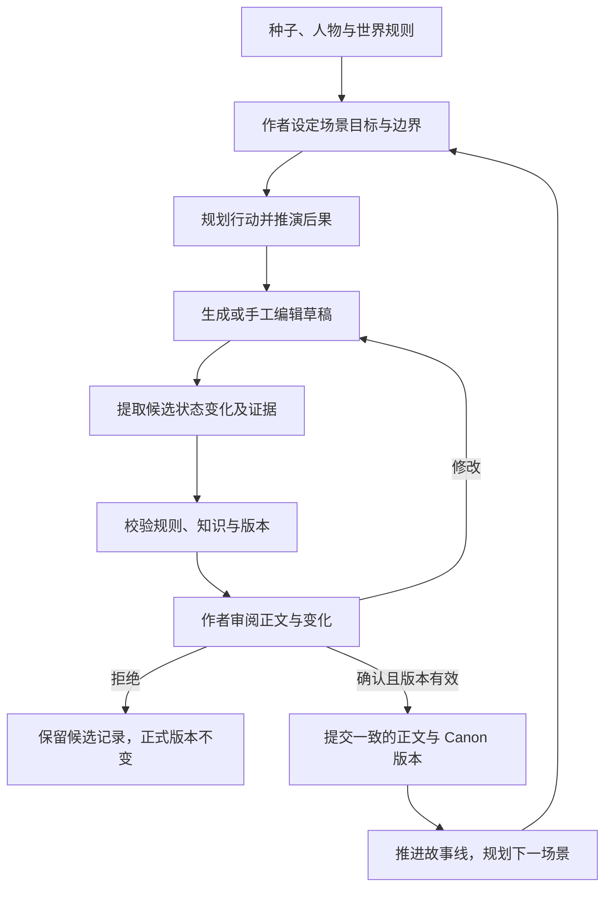

# 小说领域与作者工作流

[返回导航](README.md) · 产品需求：[产品](01-product.md) · 提交边界：[架构](04-architecture.md)

## 1. 决策状态与领域原则

**用户已确定**：以 [goal.md](../goal.md) 为出发点，作者主导，小说创作作为通用平台的首个应用。

**设计建议**：先建模作者的判断，再将判断所需信息组织为概念实体。叙事不是数值模拟；状态管理用于辅助检查，不能代替人物塑造。场景是主要创作与审阅单位，章节、卷是组织单位。

**待验证假设**：场景级状态提取可以达到可接受的漏报与误报水平；作者愿意维护少量关键约束；事件历史足以支持早期状态查询，无需完整世界模拟器。

## 2. 从创作判断到领域概念

| 作者在判断什么 | 领域概念 | 需要保留的信息与关系 |
| --- | --- | --- |
| 这个点子为什么能长成故事？ | 故事种子 | 世界异常、主角、愿望、阻碍、失败代价、核心未知 |
| 规则为什么会导致这种处境？ | 世界规则、制度、势力、地点 | 规则的条件、适用范围、代价、例外及作者确认的推演依据 |
| 这个人为什么做这个选择？ | 人物、动机、底线 | 外部目标、内部需求、恐惧、信念、资源、关系与当前处境 |
| 目标如何越来越难实现？ | 冲突、选择、后果 | 阻碍来源、可选行动、牺牲、即时结果和延迟影响 |
| 哪个问题正在演化？ | 故事线 Plotline | 核心问题、当前认知、推进节点、与其他线的交叉、解答条件 |
| 人物发生了什么内在变化？ | 人物弧 Arc | 原有信念、压力、选择证据、信念修正，不只记录能力升级 |
| 这次行动改变了什么？ | 场景 Scene、事件 Event | 时间、地点、视角、参与者、行动及前后状态变化 |
| 读者在此处应知道什么？ | 叙述安排、揭露、伏笔 | 正文顺序、信息释放范围、伏笔承诺、回收条件 |
| 哪些内容必须保持一致？ | Canon、Anchor | 已确认事实与创作边界、生效范围、来源、版本和修订记录 |

人物性格是行为倾向，不是永不变化的约束。一次违背平常习惯的选择，若有压力和成长依据，可以成立；系统应指出依据不足，不能因为“冷静的人愤怒了”就机械判错。

世界推演需要区分三类结论：由规则直接推出的限制、依赖额外假设的可能社会结构、作者选择的具体历史。例如“记忆能保留”并不必然意味着法院认可死者证词，中间还需要技术可用性、可信度及制度条件。

力量体系用“可做什么、何时能做、需要什么、付出什么、不能绕过什么”描述。成本可影响个人、经济、政治与伦理。早期以文本规则和关键事实检查承载，不把所有能力强行量化为等级数值。

## 3. 贯穿示例的共同基线

以下为设计测试样例，新增细节只属于这个虚构样例。其他文档引用本节，不另造不同版本。

| 类别 | 示例内容 |
| --- | --- |
| 作品 | 《觉醒之前》，示例标题 |
| 世界规则 | 人在十八岁觉醒；未觉醒者被帝国流放 |
| 当前世界时间 | 林烬成年前三天，记为 D-3；交换地图发生在当日傍晚 |
| 外部目标 | 找到三年前失踪的哥哥 |
| 内部需求 | 逐步接受不能控制所有结果，并学会有限地信任别人 |
| 恐惧与底线 | 害怕失去自主权；不愿主动向帝国交出身世线索 |
| 场景 | 废弃车站；林烬希望取得地图，顾清希望确认他是否可信 |
| 初始状态 | 地图由顾清持有；双方没有合作约定；顾清不知道林烬的真实身份 |
| 作者已定秘密 | 在样例基线中，哥哥主动消失以阻止觉醒实验；仅作者层可见，林烬和顾清都不知道 |
| 场景目标 | 林烬得到地图；双方暂时合作；顾清察觉隐瞒，但不知道具体身份 |
| Anchor | 本场景不得揭露哥哥主动消失的原因，也不得让顾清知道林烬的具体身份 |
| 样例版本 | 提案基于已确认作品版本 V12；作者批准后形成 V13 |

一条可能的因果链：林烬急需路线 → 顾清要求身份保证 → 林烬用可验证的局部情报交换地图 → 顾清发现回答有保留 → 达成有限合作但留下怀疑 → 下一场景既有路线资源，也多了暴露风险。

这里“顾清怀疑存在隐瞒”是一项认知变化；“顾清知道具体身份”是另一项事实，不能合并。具体交换情节仍是候选方案，作者可以改写。

## 4. 双时间线与信息边界

### 4.1 世界发生顺序和读者经历顺序

| 事件 | 世界时间 | 叙述位置示例 | 读者能获得的信息 |
| --- | --- | --- | --- |
| 哥哥失踪 | 三年前 | 第一章中的片段回忆 | 知道失踪，不知道真正原因 |
| 车站交换地图 | D-3 傍晚 | 第一章开场 | 知道地图转移与合作；知道顾清有所怀疑 |
| 实验原因揭露 | 以后某次调查 | 后续章节，尚未安排 | 到达作者批准的揭露点才能明确原因 |

叙述重排不会自动改变世界事件发生时间。倒叙按过去时点读取人物状态，不能拿 V13 中“现在持有地图”的投影替代车站之前的状态。正文同一事件可以被多次提及，每次揭露的信息不同。

### 4.2 四类信息视角

- **作者层真相**：可以包含尚未揭露的秘密。它是故事规划依据，不等于当前人物可知。
- **世界状态**：在指定时间、版本下发生了哪些事；还包括尚无人知晓的事实。
- **角色认知**：某人物知道、相信、怀疑或误解了什么，依据是什么，何时获得。相信的内容可以是错的。
- **读者已知**：截至指定叙述位置正文明确透露或暗示了什么；暗示不等于真相已揭晓。

Planner 和 Critic 可在授权范围内访问作者秘密。Writer 默认只收到当前视角与揭露边界需要的信息；可用“不要透露失踪原因”的约束替代整段秘密。这样减少泄露机会，但不宣称能完全消除模型推断与剧透风险。

## 5. Canon、草稿与版本

| 内容类别 | 权威性 | 可以怎样使用 |
| --- | --- | --- |
| 已确认 Canon | 指定版本和适用范围内的事实依据 | 用于规划、校验和上下文构建；修订必须有新版本 |
| 已确认正文 | 指定版本的正式叙述 | 不代表每句旁白、对白都是真相，尤其是不可靠叙述者与谎言 |
| 作者 Anchor | 当前生效的创作约束 | 违反时阻止直接提交；作者可显式修订并确认影响 |
| 编辑草稿 / 模型候选正文 | 尚未确认 | 可以预览、改写、比较；不能自动更新 Canon |
| 候选事实与状态变化 | 待确认的抽取或推演 | 与正文证据对照，支持删除、改正和补充 |
| 摘要 / 搜索索引 / 经验建议 | 派生或建议 | 用于定位与节省上下文，必须能回到原始版本，过期可重建 |

正文、设定与状态提案一起构成一致的审阅单元。作者可以先把满意的正文留在草稿中，不必为了保存文字而接受错误抽取。提案中的局部接受必须重新检查依赖；若删去“转交地图”，就不能保留“林烬持有地图”的状态变化。

样例状态变化：

| 维度 | V12 场景前 | 候选场景后 | 证据要求 |
| --- | --- | --- | --- |
| 物品 | 顾清持有地图 | 林烬持有地图 | 正文明确发生转交，而非只看了一眼 |
| 关系 | 没有合作约定 | 暂时合作 | 存在承诺或行动，不直接推断为信任 |
| 知识 | 顾清不知道真实身份 | 顾清怀疑林烬隐瞒身份，仍不知道具体身份 | 指向发现矛盾的段落 |
| 故事线 | 缺少调查路线 | 得到下一步线索 | 地图与寻找哥哥之间存在可解释关联 |
| 人物弧 | 抗拒依赖别人 | 做出一次有限合作 | 只记录选择证据，不直接判定“完成成长” |
| 世界 | 已有觉醒与流放规则 | 本场景未改世界规则 | 不要求每个场景六类状态都变化 |

## 6. 创作循环与角色职责

| 职责 | 输入 | 输出 | 无权自行完成的事情 |
| --- | --- | --- | --- |
| Planner | 目标、规则、人物动机、故事线、历史状态 | 行动方案、代价、预期变化 | 把预期变化写成已发生事实 |
| Writer | 作者选择的方案、视角上下文、文风与边界 | 候选正文 | 为了顺畅擅改世界规则或已知事实 |
| Critic | 正文、约束、前态、变化提案 | 有证据的问题与编辑意见 | 以主观评分代替作者批准 |
| Keeper | 草稿证据、已确认实体、版本 | 候选事实、关联与影响清单 | 自动批准 Canon 或绕过事务提交 |

这些是可测试的职责与提示配置，首期顺序执行即可。真正更新正式版本的是受控应用服务；Keeper 不是具有无限写权限的“记忆管理员”。循环无有效改进时应呈现问题并等待作者选择，不能无限自我修改。

## 7. 修改历史内容如何影响后文

假设作者在 V13 后把车站正文改为“顾清只让林烬看地图，没有交给他”。系统先保存修改草稿，再生成影响提案：地图持有者应保持顾清；后文“林烬展开地图”可能不成立；已生成摘要、检索条目和后续规划需要复核。

已明确记录的依赖可以确定列出；通过文本检索和模型发现的间接影响标为可能影响，不承诺完整识别。后续章节维持原版本并显示“待复核”，作者选择修改车站、修改后文或解释新的转交事件。

新版本提交后，旧版本及其证据仍可查看；恢复旧作品也应作为新的版本操作，并同时考虑正式正文与 Canon。仅在编辑器撤销几个字不等于撤销一次已确认的作品提交。

## 8. 一致性检查的分层

| 检查层 | 示例 | 处理方式 |
| --- | --- | --- |
| 确定性约束 | 引用实体不存在、基础版本过期、一次提交缺少关联变更 | 阻止提交并说明修复方法 |
| 明确的领域约束 | 已锁定的揭露边界被违反、已确认的地图归属与提案冲突 | 展示来源；修正文或显式提出 Canon/Anchor 修订 |
| 推理检查 | 人物可能缺少获取消息的途径、旅行时长可能不合理 | 给出证据与不确定性，由作者裁决 |
| 文学评审 | 对话缺乏潜台词、代价偏弱、场景节奏平 | 建议替代方案，不以分数强制否决 |

Story Graph 先是概念关系：人物—参与—事件、事件—导致—后果、场景—推进—故事线、事实—支撑—正文。存储可用关系表承载；需要更复杂遍历后再讨论图数据库。长期经验只提出“作者多次拒绝过早揭露”等可追溯建议，不能悄悄强化成永久规则。
