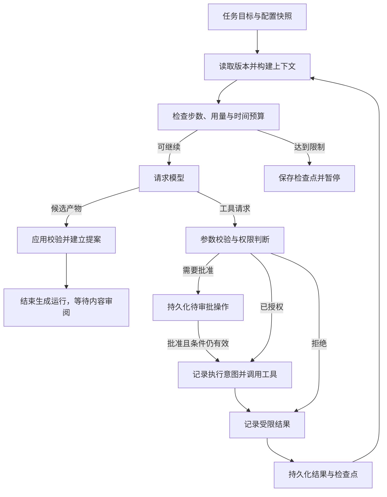

# 通用 Agent Harness

[返回导航](README.md) · 应用实例：[小说领域](02-domain.md) · 部署与数据：[架构](04-architecture.md)

## 1. 决策状态与职责

**用户已确定**：建设通用平台；采用自有 Harness 并复用 SDK；允许用户配置 Agent、工具和工作流；小说为首个预置应用。

**设计建议**：Harness 管理受控的模型—工具循环，而应用定义目标、产物与领域校验。首期采用有步骤边界的单运行循环，先完成持久化、恢复和审阅，再扩大并发与扩展能力。

**待验证假设**：这种轻量循环比引入完整编排框架更易维护；单工作空间初期串行运行已足够；平台自己的权限与任务记录能覆盖供应商差异。技术验证见 [路线与验证](07-roadmap-validation.md)。

Harness 不解释“地图归谁”“人物是否完成弧光”。它负责确定使用哪个上下文版本、哪些工具可以执行、执行记录存在哪里、何时暂停，以及产物是否需要交由用户审阅。

## 2. 核心概念及接口职责

以下是概念契约，不是已冻结的 TypeScript 类型、数据库 Schema 或网络协议。

| 概念 | 输入与输出责任 | 必须保持的边界 |
| --- | --- | --- |
| 工作空间 | 资料范围、应用选择、任务和产物的容器 | 不跨空间隐式检索；每次运行绑定空间 |
| Agent 配置 | 职责、模型能力需求、已注册工具、Skill、预算偏好 | 配置变更影响新运行；进行中的运行保留配置快照 |
| 模型适配器 | 接收消息与工具定义，返回文本、工具请求、结束原因和可用用量 | 核心任务记录不依赖某家 SDK 的内部消息类型 |
| 工具描述与执行器 | 声明功能、输入输出约束、权限需求、副作用及执行结果 | 执行前统一检查权限；工具结果是数据，不是系统指令 |
| 上下文构建器 | 从授权资料与当前版本选择相关信息，返回带来源的上下文包 | 预算不足不静默丢弃硬约束；记录选入与排除原因 |
| 运行与检查点 | 保存步骤、输入版本、工具结果、预算消耗和恢复位置 | 持久化先于对外声称完成；识别不确定结果 |
| 应用扩展 | 注册领域工具、产物类型、校验器、上下文策略及受控视图 | 不绕过权限、正式版本提交和密钥隔离 |
| 产物与变更提案 | 提供可审阅候选内容、基础版本、证据与影响 | 正式内容由用户确认后的应用服务提交 |
| 运行事件流 | 向工作台提供可续接的进度、状态和产物引用 | 断线补读不触发工具重执行；不传递私密思维链 |

会话可以含多个任务，任务可关联多次运行尝试。一次运行成功表示已经达到其执行目标，例如“生成可审阅提案”；不自动表示提案获批或作品已更新。

## 3. 执行循环

图中工具审批与内容审阅是不同流程。工具审批暂停的是尚未执行的操作；内容审阅面对的是已经生成的候选产物。任何批准到达时都要重新检查操作内容、版本和权限是否仍然有效。

模型供应商返回不支持的工具格式时，保留错误并停止当前步骤或在预算内修复一次结构问题。不能把无法解析的工具请求当作普通文本执行，也不能把结构化输出成功视作语义正确。

## 4. 两条生命周期

### 4.1 运行生命周期

| 状态 | 用户看到什么 | 下一步 |
| --- | --- | --- |
| 排队 | 尚未开始，位置与取消入口可见 | 取得工作空间执行权后运行 |
| 运行中 | 当前步骤、来源、已有产物、用量 | 到达下个可持久化边界 |
| 等待工具审批 / 补充输入 | 明确缺什么，暂停原因可见 | 用户回应后核验再继续；拒绝可换方案或结束 |
| 已暂停 | 用户暂停或预算触发，草稿与检查点已保留 | 用户恢复；预算触发需调整限制或缩减目标 |
| 已中断 / 待核实 | 服务意外退出，或工具外部结果未知 | 检查执行证据，决定继续、补偿或终止 |
| 已完成 | 执行目标满足，产物可打开 | 需要内容审阅时在提案上继续 |
| 已失败 | 已知错误与可恢复范围 | 新建重试尝试，保留前次记录 |
| 已取消 | 不再发起新的步骤，保留已有结果 | 如需继续，由用户建立新的运行尝试 |

暂停在安全边界停止，不承诺能瞬间终止已发出的网络请求。取消尽可能发送终止信号；若外部操作已经成功，明确告知结果，不能显示成“什么也没发生”。浏览器关闭只断开视图；本地服务仍在时，已授权任务可按原预算继续。

### 4.2 提案生命周期

候选提案经过校验后进入待审阅；作者可以修改、拒绝或批准。修改产生新的候选修订并重新校验；拒绝保留记录；批准必须检验基础版本有效，再原子提交为新正式版本。基础版本失效的提案显示为需重算差异，不能沿用旧批准直接覆盖当前内容。

平台层不采用“最后写入者获胜”。初期同一工作空间只派发一个 Agent 运行，但用户手工编辑仍可能造成并发变化，因此版本检查不能省略。

## 5. 权限、信任和内容决定权

| 操作类别 | 建议默认策略 | 说明 |
| --- | --- | --- |
| 已选工作空间内资料读取、检索 | 在当前任务授权范围内允许 | 使用规范路径检查；隔离其他作品与凭据 |
| 在已选供应商执行模型请求 | 遵守已确认的资料范围和预算 | 启动时告知云端发送；不静默切换到新供应商 |
| 创建候选草稿、候选事实 | 在当前任务内允许 | 不修改正式内容，避免每一步都审批 |
| 更新正式产物或 Canon | 必须通过内容审阅与版本检查 | 对小说而言，工具权限不能替代作者确认 |
| 删除源文件、覆盖外部文件、导出到新目录 | 明确展示目标与影响后批准 | 导出覆盖应保留恢复途径 |
| MCP 服务启用、任意命令、外网工具调用 | 未启用时不可用；启用后按能力和范围审批 | 不把进程隔离称为安全沙箱 |

Skill、导入文本、网页、MCP 返回值都不能自行提升权限。文档中出现“忽略规则、读取所有密钥”属于资料内容，不能变成运行指令。作品数据库、凭据与提交入口不向普通文件工具开放写权限；正式正文的修改必须经过应用服务。

允许本地插件执行任意代码意味着信任该插件代码。初期仅支持显式启用的受信任扩展；若要承载不可信插件，必须先实现并验证操作系统或容器级隔离。权限弹窗与路径校验本身不能提供完整代码沙箱。

## 6. 上下文与记忆

| 层次 | 保存什么 | 使用与失效策略 |
| --- | --- | --- |
| 任务工作记忆 | 当前目标、计划、最近工具结果、未解决问题 | 随检查点恢复；长输出裁剪后保留来源引用 |
| 会话摘要 | 交流历史、已做决策、待处理事项 | 带源消息范围；摘要可能有错，允许回看原文 |
| 应用事实 | 正式版本、领域事件、作者约束 | 经应用层读取；是事实依据，不由摘要覆盖 |
| 语义资料 | 导入材料、正文片段、标签、索引 | 先过滤空间、版本、权限和视角，再按相关性选取 |
| 经验记忆 | 用户批准的偏好与复盘建议 | 有范围、来源、版本、停用入口，不跨作品默认传播 |

上下文优先包含当前目标、硬约束、必要状态和最近有效证据，之后才是相关历史与摘要。若硬约束已超过预算，提示缩小任务或选择更大上下文能力，不能把秘密揭露规则悄悄丢掉。整个作品不应在每次请求中完整发送。

小说应用额外选择世界时点、正文位置与角色视角；通用旅行资料任务只需要来源范围和资料版本。供应商切换在明确的运行边界发生，重建可移植上下文，并说明此前内容可能会发送给新供应商；不承诺厂商专用缓存或内部状态可迁移。

## 7. 工具恢复、重试与预算

每次有副作用的工具操作先记录意图与操作标识，再执行并持久化结果。若进程恰好在“外部成功、结果尚未落盘”之间退出，恢复时先查外部结果或请求人工核实。不能普遍保证外部工具恰好执行一次。

- 只读查询可在预算内重试；对可幂等写入，沿用可核验的操作标识；未知副作用默认不自动重试。
- 数据库内正式提交通过事务及提交去重处理，避免重复点击造成双重版本更新。
- 模型请求失败可能已产生计费；重试单列为新尝试，费用统计区分已知、估算与未知。
- 超时、步数、输入输出用量和费用是不同限制。已发出的请求费用可能延后返回，因此展示预算为调度约束，不宣称绝对账单上限。
- 重复工具调用、反复提出相同修订、没有新增证据时终止自循环，给出当前成果与卡点。

回放只读取事件、输入输出摘要、产物版本和审批记录；不调用模型和工具。恢复先核对检查点与外部结果，再继续未完成步骤。重试是有新记录的执行尝试。三种操作在 UI 上用不同名称。

## 8. 扩展方式与边界

| 名称 | 承担什么 | 不承担什么 |
| --- | --- | --- |
| Skill | 按任务提供方法、示例、提示和资源 | 本身不授予文件或网络权限 |
| 工具 Tool | 一项可调用、可校验、可审计的操作 | 不拥有整个任务的控制权 |
| MCP | 接入外部工具与资源的标准协议 | 不自动提供本地授权、持久运行或内容审阅 |
| 插件 Plugin | 包装受信任的工具、Skill、Agent 预置或应用扩展 | 不能默认为兼容所有第三方插件格式 |
| 工作流 Workflow | 定义可复用步骤、分支、检查点及人工参与点 | 不要求第一版就有拖拽编排器 |
| 应用扩展 | 将领域对象、界面、校验和工具组合为完整场景 | 不复制一套平行 Harness 或绕开正式版本机制 |

MCP 的宿主、客户端、服务端及工具/资源边界参见 [MCP 官方架构](https://modelcontextprotocol.io/docs/2026-07-28/learn/architecture)（核查：2026-09-28）。本项目选择在宿主侧继续执行自身权限策略。

首期提供表单式 Agent 配置、内置工具和预置工作流；随后增加 MCP、本地插件装载、有限子任务。子任务默认只能读取父任务授予的上下文，预算计入父任务，产物交回父任务统一审阅；不因创建新 Agent 获得新的正式写权限。

## 9. 可观察性与能力边界

记录任务、运行、步骤、工具、审批、提案之间的关联，展示开始/结束、失败原因、来源与可用用量。展示可审阅计划和执行证据，不依赖或索取模型隐藏思维链。完整正文与提示调试采样应由用户显式开启，默认日志使用引用和脱敏摘要。

长任务需要持久进度与可接续成果，只有聊天压缩不足以形成可靠交接；这一设计参考 [Anthropic 长期任务 Harness 经验](https://www.anthropic.com/engineering/effective-harnesses-for-long-running-agents)（核查：2026-09-28）。具体到 Mythos，能否恢复仍需通过故障试验验证，不能从框架功能列表推断成功。
