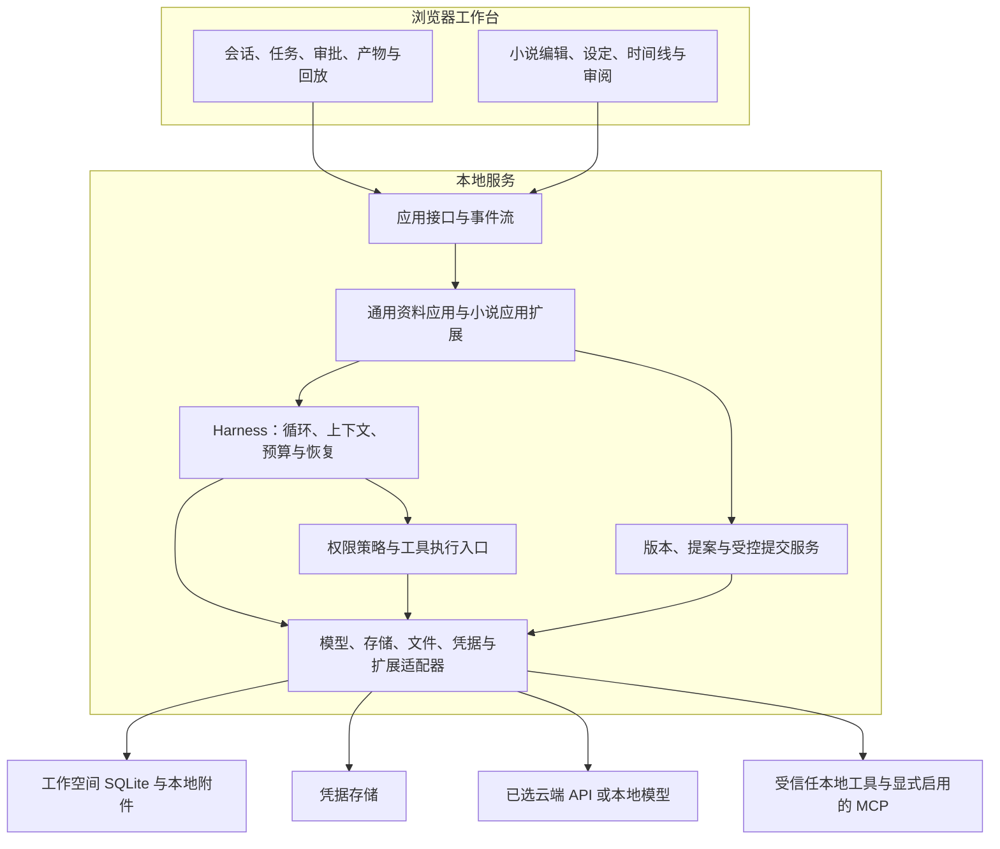
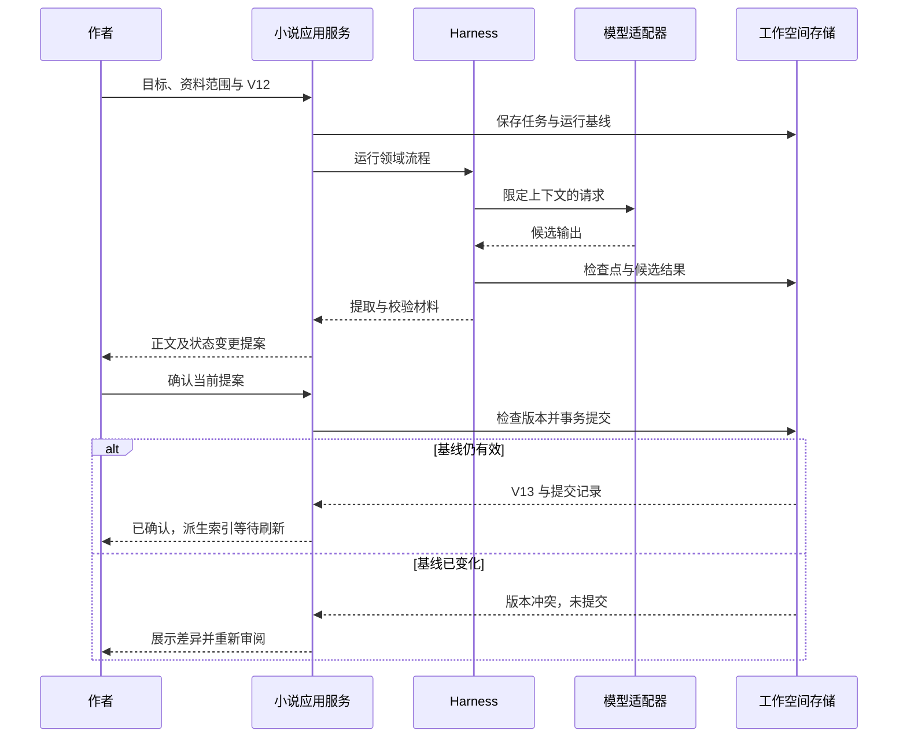

# 系统架构与数据边界

[返回导航](README.md) · 运行规则：[Harness](03-harness.md) · 技术依据：[选型](05-technology.md)

## 1. 决策状态与架构风格

**用户已确定**：本地 Web、自有 Harness、TypeScript 优先、通用平台加小说应用、多供应商密钥接入。

**设计建议**：以模块化单体起步。一个本地 Node.js 服务提供前端静态资源、应用接口、事件流和任务调度；模型、文件、凭据与扩展通过适配器接入。浏览器是工作视图，不承担长任务存活与权威数据存储职责。

**待验证假设**：单服务与 SQLite 能支持早期目标负载；将耗时解析和外部工具放到受控工作进程就能满足响应性需求；跨平台凭据与原生依赖的打包成本可控。这里的工作进程隔离用于生命周期管理，不构成不可信代码沙箱。

## 2. 逻辑分层

图表示职责与数据流，不要求每个方块独立部署。生产形态由本地服务同源提供 Web 页面；开发时可独立启动 Vite，但不把开发服务器作为发行方式。默认只监听回环地址，不自动开放局域网。

## 3. 模块责任与依赖方向

| 模块 | 责任 | 边界 |
| --- | --- | --- |
| 工作台壳层 | 空间切换、会话、任务列表、设置、审批、产物审阅 | 领域视图注册在应用层；无需在聊天组件里解释所有小说概念 |
| 通用应用服务 | 资料导入、产物版本、任务目标、导出和备份 | 给不同应用提供一致的用户操作入口 |
| 小说应用 | 领域对象、时间线、状态抽取、Canon 校验、变更影响 | 依赖平台契约，不直接依赖某一家模型 SDK |
| Harness 核心 | 执行状态、上下文计划、工具调度、预算、检查点 | 不导入人物、场景等领域实体类型 |
| 提交服务 | 校验基础版本、作者批准、写入一致新版本 | 模型与通用文件工具不能绕开它更新正式作品 |
| 适配器 | SDK、SQLite、文件系统、MCP、凭据的实现 | 向内转换外部类型和错误；更换适配器不改变核心概念 |

建议将这些边界组织为 TypeScript 工作区包：工作台、本地服务、核心契约、Harness、适配器和小说应用。具体目录与包名在实施详细设计中确定，当前无需制造空代码骨架。

## 4. 一次场景任务的数据流

1. 浏览器提交目标：在 V12 基线上完成车站交换地图场景，保留身份秘密。
2. 应用服务保存任务和配置快照。小说应用提供当前场景时点、人物可知信息、规则与 Anchor。
3. Harness 根据预算构建上下文，经模型适配器请求规划或正文；只在服务端取得密钥。
4. 工具请求由统一入口检查权限，结果与进度被持久化后通过事件流通知界面。
5. 小说应用提取地图归属、临时合作和顾清怀疑等变化，输出带证据的候选提案。
6. 生成运行完成，提案等待作者。作者修改正文后重新抽取和校验，旧校验结论不得沿用。
7. 作者批准时，提交服务验证提案与当前版本；在一个工作空间事务内写入正式正文版本、Canon 变化、批准记录及必要的派生更新任务。
8. 成功后界面显示 V13；索引与摘要可以稍后刷新，但尚未刷新时不得把 V12 的索引结果伪装成 V13 事实。

版本检查和写入必须处于同一事务边界内，避免“检查时有效，落盘时已过期”。提交记录用于重复请求去重；事件流重连、重复点击与工具重试不能产生重复正式提交。

## 5. 权威数据与存储分工

| 存储内容 | 建议位置 | 权威性与恢复原则 |
| --- | --- | --- |
| 空间目录、全局偏好、供应商非敏感配置 | 实例级本地配置/目录库 | 保存引用，不跨库复制作品事实 |
| 正式正文版本、编辑草稿、领域事实/事件、提案、任务、检查点 | 每个工作空间独立 SQLite | 业务权威数据；Canon 和正式正文在同一事务中提交 |
| 来源附件与大文件 | 空间内受管附件区 | 稳定引用、完整性校验；附件变化必须有新引用或版本 |
| 摘要、全文检索索引、后续可选向量 | 空间内派生存储 | 可重建；关联源版本，不能反向覆盖事实 |
| API 密钥、MCP 凭据 | 操作系统凭据存储适配器 | 不随作品导出；初期不可用时用仅本次会话输入，不退回明文落盘 |
| 诊断日志与运行事件 | 本地服务诊断区及空间运行记录 | 分开诊断与审计；默认脱敏，提供容量和保留期管理 |

正文建议保存结构化编辑内容及其版本；搜索用纯文本和 Markdown/TXT 导出从该版本派生。它们不作为可独立写回的第二份权威正文。内容模型与场景/段落的稳定引用在详细设计中确定，以支持证据定位和变更对照。

文件系统与数据库之间没有天然的跨介质事务。附件先写入暂存区并校验，形成可用的稳定文件后，数据库才引用它；中断留下的未引用文件可识别并清理，不能先提交引用再假定文件一定存在。正式文本及其状态更新尽量留在同一数据库事务内。

## 6. 状态投影、修订与失效

领域事件表达指定故事时间发生了什么；事实和约束带有效范围；当前状态视图只是查询便利。需要过去时点时，由有效事实、事件和快照重建，而不是修改“当前值”去模拟历史。

业务版本回答“作者在哪一版作品里批准了什么”，世界时间回答“故事内何时发生”，运行时间回答“Agent 何时处理”。三者分别管理。早期无需对每个数据库写入实现完整事件溯源，但必须保留正式版本和状态变更证据。

当车站正文从“转交地图”改为“只展示地图”，应用服务建立待审提案与后文影响清单。提交新版本后将依赖的摘要、索引和未确认后续草稿标为过期；旧正式章节标记待复核，不能自动抹掉或重写。派生重建失败不撤销已完成业务提交，界面显示索引未更新，并用直接查询或过滤过期条目维持正确性。

## 7. 任务存活、事件流与接口分组

建议用普通 HTTP 承载命令与查询，以 SSE 承载从服务到浏览器的单向进度。选择基于当前无实时协作的需求；未来双向高频输入再评估 WebSocket。具体 URL、事件字段和错误码留待详细设计。

接口按职责分为：工作空间与资料、Agent 与模型配置、任务与运行控制、工具审批、产物与提案审阅、领域查询、备份导出。变更操作必须有明确的结果标识；进度订阅允许从上次位置补读，超出保留范围时重新获取状态快照。

调度先采用每空间一个活动运行，防止大量并发写入；跨空间全局并发设有限额，并共同受供应商和费用限制。服务重启把未结束运行归入恢复核查，不能仅凭“上次是运行中”就自动重放最后一个外部写操作。检查点只代表记录边界，不能证明外部副作用未发生。

## 8. 本地安全与部署边界

建议绑定回环地址、校验 Host/Origin、使用本机访问会话凭据并限制跨源调用。单用户产品仍需要防止恶意网页调用本地服务；不能把“没有公网地址”视作不需要访问控制。浏览器只看到密钥是否配置及脱敏标识，模型请求由服务端发出。

授权文件目录需规范化并处理 Windows 盘符、符号链接、junction 和越界路径。普通工具不得读取凭据或写入平台内部数据库。Shell 或插件代码可能绕过应用级文件工具限制，因此早期仅对明确受信任的扩展开放，不宣称完成 OS 级沙箱隔离。

发布为本地服务与前端构建产物，提供清晰的启动、退出、端口占用和升级路径；启动器与安装包形式在技术试验后细化。关闭浏览器不会关闭服务，关闭服务会提示正在运行的任务。当前设计不需要 Docker、云数据库或独立队列才能开始使用。

## 9. 备份、导出与未来迁移

TXT/Markdown 导出用于阅读和携带正文，不包含所有任务、事实和版本。完整备份包含一致的工作空间数据库快照、被引用附件、格式版本与完整性清单，默认不包含密钥。备份必须在写入协调或数据库一致快照机制下执行，不能简单复制正在使用的数据库文件并忽略日志文件。

恢复先校验格式、版本和附件完整性，导入为新工作空间再由用户选择切换，避免直接覆盖现有作品。升级前备份；迁移失败保持原作品可读，禁止半迁移后继续写入。

未来若需要远程多用户，可替换服务部署、身份与存储适配；SQLite 到 PostgreSQL 的迁移也需处理事务和并发差异，不承诺改一个连接字符串即可完成。先验证当前使用规模，再决定分布式任务系统、云同步或协作协议。
