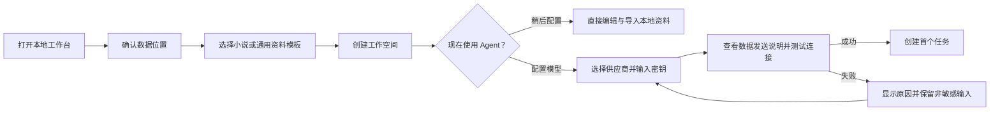

# UI/UX 与核心用户旅程

[返回导航](README.md) · 需求依据：[产品](01-product.md) · 状态语义：[Harness](03-harness.md)

## 1. 决策状态与体验原则

**用户已确定**：个人本地 Web、作者主导、通用 Agent 平台与小说预置应用。当前交付是概念交互设计，不包含可运行页面或高保真原型。

**设计建议**：桌面优先、中文优先、以正文和产物为中心；聊天负责表达意图，计划与运行卡展示执行，审阅面板负责正式变更。通用工作台与小说工作台共享导航、运行、审批和设置。

**待验证假设**：三栏布局能兼顾长文编辑与证据核对；按场景分组审阅可以降低确认负担；用户能理解草稿保存与正式提交的区别。需通过任务走查和后续可用性测试验证。

界面回答四个问题：我在处理哪个作品或资料集？Agent 当前在做什么？哪些内容已经保存或生效？此刻需要我决定什么？运行细节默认折叠，来源与风险在作出决定的位置可展开。

## 2. 信息架构

| 层级 | 入口 | 内容 |
| --- | --- | --- |
| 全局 | 工作空间、设置 | 最近作品/资料集、创建入口、模型与密钥、存储备份、扩展 |
| 工作空间 | 概览、会话、产物、资料、运行 | 当前目标、待审阅事项、文件来源、历史任务 |
| 小说扩展 | 正文、人物、世界规则、故事线、时间线 | 作品结构、领域资料、状态和创作进度 |
| 工作区侧栏 | 助手、证据、变化、历史 | 与当前选中场景或产物相关的上下文 |

通用资料空间不出现“人物”“Canon”等小说栏目。小说空间默认进入最近编辑的场景，可切换专注写作视图隐藏两侧面板。全局待处理徽标只显示需要用户操作的事项，不把每个工具调用都变成通知。

## 3. 首次使用与创建作品



默认工作空间位置建议为用户文档目录中的 Mythos 子目录，用户可更改。创建失败明确提示目录权限或磁盘问题，不在后台悄悄换位置。选择资料时显示将读取的文件范围；云模型配置说明内容会发送给哪个供应商。连接测试如会发起计费请求，应在按钮附近说明；错误信息不得回显密钥。

```text
Mythos / 新建工作空间

类型        (●) 小说创作  ( ) 通用资料
名称        [ 觉醒之前                           ]
保存位置    [ 用户文档目录 / Mythos / 觉醒之前   ] [更改]

故事从六个问题开始                         [稍后填写]
世界有什么异常？   [ 十八岁觉醒，失败者被流放   ]
主角是谁？         [ 林烬                     ]
现在最想要什么？   [ 找到失踪的哥哥           ]
为什么得不到？     [ 缺少线索，身份不能暴露   ]
失败会失去什么？   [ 与哥哥重逢的机会         ]
最大的未知是什么？ [ 哥哥为什么失踪           ]

模型：尚未配置。可以先创建作品并手工编辑。
                                             [创建作品]
```

六问允许部分填写，不要求用户先建立庞大的世界百科。后续助手围绕缺失的行动理由追问，并把新增设定保留为建议。

## 4. 通用工作台线框

建议在宽屏下使用左导航、中间会话/计划、右产物区；三栏可调整。示例任务只使用导入的旅行笔记，不自动上网。

```text
Mythos  /  旅行资料                     模型：已选供应商  [设置]
┌────────────────┬──────────────────────────┬────────────────────┐
│ 工作空间       │ 整理三份旅行笔记         │ 产物：地点清单     │
│  概览          │ 范围：仅已导入资料       │ [候选版] [来源]    │
│  会话          │                          │                    │
│  产物          │ 计划                     │ 地点 A             │
│  资料（3）     │ ✓ 读取授权资料           │ 摘要…… [笔记1 §2]  │
│  运行          │ → 提取地点与冲突         │                    │
│                │ ○ 生成带来源汇总         │ 信息冲突（1）      │
│ 资料助手 [编辑]│                          │ 笔记2 与笔记3……    │
│                │ 已保存当前进度 [暂停]    │                    │
│                │                          │ [编辑候选版]       │
│                │ [补充任务要求……        ]│ [审阅并确认版本]   │
└────────────────┴──────────────────────────┴────────────────────┘
```

运行中补充要求先进入待处理指示，在下个安全步骤接纳；已经生成的提案若因此失效应重算。不要把用户输入立即混入正在完成的外部操作。右侧产物以来源链接为主要解释方式，点击打开笔记定位片段而非另起聊天。

Agent 配置页用职责、模型、工具、Skill、预算五组表单组织；工具列显示能力与授权范围。初期选择已注册工具，后续扩展页才出现 MCP 服务与插件来源、启停和更新权限说明。

## 5. 小说工作台线框

```text
Mythos / 觉醒之前 / 第一章 / 废弃车站
正式作品 V12     当前草稿已保存     模型：已选供应商      [专注写作]
┌────────────────┬────────────────────────────┬────────────────────┐
│ 正文           │ 废弃车站                   │ [助手] 设定 变化   │
│ ▾ 第一卷       │ 世界时间：D-3 傍晚         │                    │
│   ▾ 第一章     │ 叙述位置：第一章开场       │ 场景目标           │
│     废弃车站 ● │ 视角：林烬                 │ 取得地图，暂时合作 │
│     回忆片段   │                            │                    │
│ 人物           │ 正文编辑区域……             │ 揭露边界           │
│ 世界规则       │                            │ 顾清不能知道身份   │
│ 故事线         │ 选中文字可提出改写请求     │ 失踪原因不能揭露   │
│ 时间线         │ 模型候选在独立区域预览     │                    │
│                │                            │ [讨论行动方案]     │
│ 待审阅（1）    │                            │ [生成场景草稿]     │
│                │                            │ [查看候选与变化]   │
└────────────────┴────────────────────────────┴────────────────────┘
```

左侧圆点必须有“存在草稿”的可访问文字说明。字数为辅助信息，不用完成百分比暗示故事质量。正文可手工编辑；自动保存回执只在服务成功保存后显示。网络断开时显示未保存状态并保留本地编辑缓冲，提供复制或下载应急草稿入口。

选区改写会带上选区、必要上下文及适用约束。生成结果不会流式替换正在输入的文本；用户接受候选后更新编辑草稿，再进入场景审阅。若生成期间草稿变化，展示对照并要求重新合并，不能覆盖新输入。

## 6. 领域辅助视图

| 视图 | 默认展示 | 关键操作 |
| --- | --- | --- |
| 人物 | 外部目标、内部需求、恐惧、底线、当前处境和变化证据 | 查看指定世界时点的状态；从引用回到正文 |
| 世界规则 | 规则、成本、例外、适用范围、推演假设 | 提出规则修订；查看受影响内容 |
| 故事线 | 核心问题、已推进节点、当前悬而未决的问题 | 关联场景；记录揭露或回收条件 |
| 时间线 | “世界发生顺序 / 正文叙述顺序”两个明确模式 | 从同一事件跳转两种顺序；调整叙述位置不改世界时间 |
| 信息视角 | “作者全知 / 当前人物 / 读者至此” | 区分知道、相信、怀疑；显示作者秘密标识 |

作者秘密在资料视图中可以阅读，但默认不进入当前人物的上下文包，也不混入正文导出。切换到作者全知视图只改变展示，不意味着自动把所有秘密发送给模型。

## 7. 正文与状态变更审阅

```text
审阅：废弃车站                           基础版本 V12
候选正文与状态已校验                     [查看引用与影响]
┌─────────────────────────────┬──────────────────────────────┐
│ [正文差异] [完整候选正文]    │ 状态变化                     │
│                             │ 地图：顾清 → 林烬     [证据] │
│ + 顾清把地图递给林烬……      │ 关系：暂时合作        [证据] │
│ + 她看出他的回答有所保留……  │ 知识：怀疑隐瞒身份    [证据] │
│                             │ 仍未知：具体身份             │
│                             │                              │
│ [继续编辑草稿]              │ 注意：成长依据较弱    [建议] │
└─────────────────────────────┴──────────────────────────────┘
确认会同时更新正式正文与以上状态；候选草稿已保存。
[拒绝提案] [返回修改]                    [确认场景并更新作品]
```

按场景展示一个连贯提案，用户可以展开修正某条变化，但依赖被改动后必须重新校验整个提案。确认按钮显示当前基础版本；提交期间防止重复点击，结果明确显示 V13 或“版本已变化，未提交”。

问题分为“必须处理”和“编辑建议”。版本冲突、缺失引用、已确认规则冲突等不能用忽略按钮直接跳过；作者有意变更设定时进入明确的规则修订提案。主观编辑建议允许保留原文，不要求达到模型评分才可确认。

拒绝后正式作品仍是 V12，候选与拒绝理由保留。确认后若要恢复旧内容，进入“恢复为新版本”的审阅流程，同时检查正文与状态；不把文本编辑器的撤销键解释为数据库版本回滚。

### 工具审批卡

工具审批卡显示“要做什么、目标范围、为什么需要、可能的副作用”。例如导出覆盖文件时展示具体目标、覆盖提示和可恢复方式。提供“允许这一次 / 拒绝”；对可复用的只读权限可另设范围清晰的授权入口，不出现默认全盘授权选项。

作者确认正文的卡片不得使用“允许工具”文案；启用某个工具也不能被理解为以后无需审阅正文。

## 8. 中断与恢复旅程

```text
运行记录 / 生成废弃车站草稿

状态：已中断，需要核实
最后已保存：正文候选与状态提取完成
未确认操作：导出文件是否成功
正式作品：仍为 V12

[查看历史记录]   [检查导出结果]   [结束此运行]
核实完成后： [从可恢复步骤继续]
```

只读历史不重复调用工具。重试会显示新的运行尝试和潜在新增用量。若只是浏览器断线而服务仍在运行，重连后直接补齐已有进度，不显示“重新生成”。预算触发暂停时同时显示已用额度、可能未结算的调用和调整预算/缩减目标的选择。

## 9. 全局状态与微文案

| 状态 | 页面行为 | 推荐文案或操作 |
| --- | --- | --- |
| 空白作品 | 六问入口与手工编辑并列 | “从一个人物想做却做不到的事开始。” |
| 未配置模型 | 不阻止阅读、导入与编辑 | “配置模型后可使用助手。” |
| 运行中 | 阶段与已产生内容可见，不伪造精确进度 | “正在检查角色可知信息。” |
| 等待工具审批 | 提升当前待处理卡，不遮住原稿 | “需要允许读取你选择的额外资料。” |
| 待内容审阅 | 显示候选版与正式版 | “草稿已生成，正式作品尚未更新。” |
| API 失败 | 保留已有草稿与运行证据 | “本次请求失败；可检查配置或重试此步骤。” |
| 版本冲突 | 禁止旧提案覆盖，提供差异 | “作品已更新，请合并后重新确认。” |
| 保存失败 | 明确未保存，保留编辑缓冲 | “尚未保存到本地服务，可复制草稿。” |
| 索引过期 | 不以过期摘要当事实 | “检索索引正在更新，部分结果暂不可用。” |
| 取消已请求 | 区分停止派发与外部操作结束 | “正在停止；已发出的操作正在核实。” |

## 10. 视觉与交互规范建议

- **颜色**：浅色默认使用纸白背景 `#F7F5F0`、白色内容面、深灰正文 `#20242B`、靛蓝主操作 `#3F51B5`。警告、错误与成功同时使用文字和图标；深色模式作为后续同语义主题，不简单反色。
- **排版**：界面使用系统中文无衬线字体；正文可切换系统衬线字体。正文建议 18px、约 1.8 行高、单行约 32–42 个汉字，字号与行宽可调整。使用本地字体栈，不要求在线字体服务。
- **间距与布局**：采用 4/8px 间距基准，宽屏导航约 220px、右侧面板约 320px，中间尽量保证阅读宽度。窄于约 1100px 时折叠资料面板，更窄时使用单区切换，不能挤压正文到不可读。
- **键盘**：导航、树形目录、编辑器、审批和审阅按钮均可达，焦点可见。`Ctrl+K` 打开命令入口；`Ctrl+Enter` 仅在任务输入框提交请求，正式作品确认使用独立按钮避免误触。
- **可访问性**：普通文字对比度目标至少 4.5:1；支持缩放到 200%；分栏拖动提供键盘替代；状态播报采用阶段更新，不逐 token 打断屏幕阅读器。
- **动效**：弱化持续闪烁与背景动画，遵循减少动态效果偏好；流式生成不会自动抢走正文焦点或把用户滚动位置拉到底部。

上述尺寸和颜色是原型起点，不是已经完成视觉验收的设计系统。详细设计阶段需补充组件状态样例，并以中文输入法、长段落、200% 缩放、键盘和屏幕阅读路径复核。
